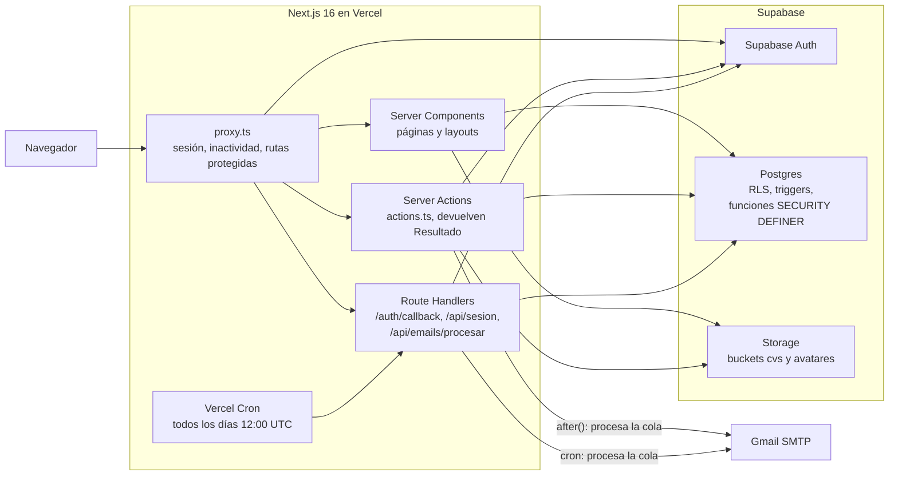
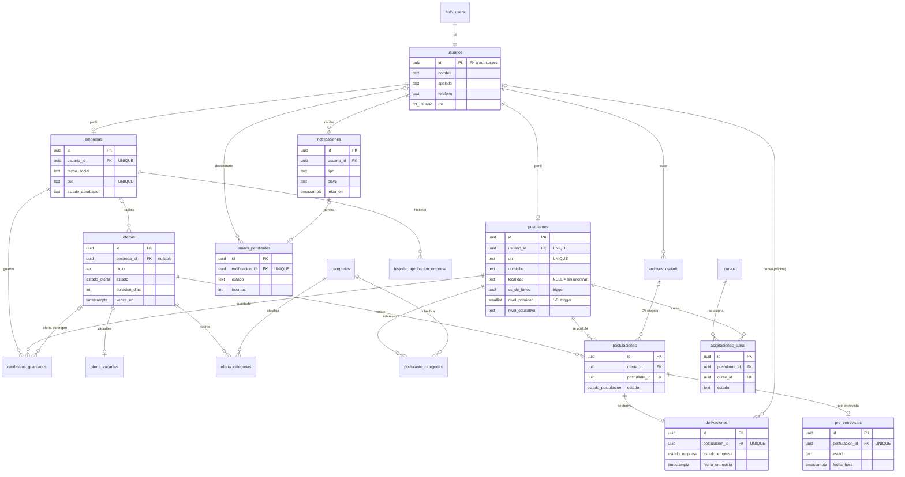
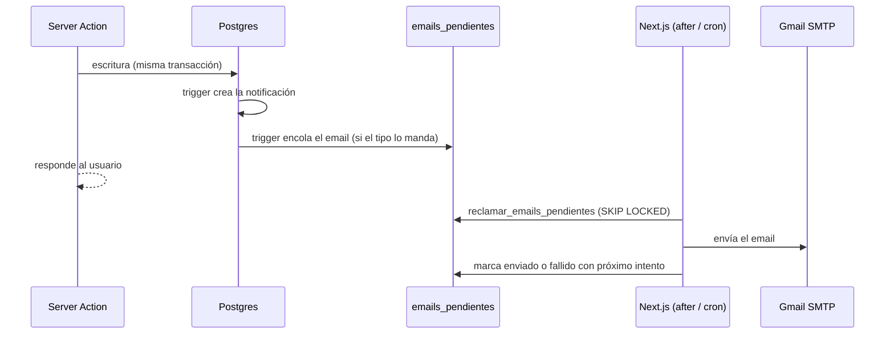

# Documentación técnica — Portal de Empleo Funes

Detalle técnico del portal. Para la presentación general (funcionalidades, integrantes y usuarios demo) ver el [README](../README.md).

## Índice

1. [Arquitectura](#1-arquitectura)
2. [Base de datos y relaciones](#2-base-de-datos-y-relaciones)
3. [Autenticación y autorización](#3-autenticación-y-autorización)
4. [Persistencia e integridad](#4-persistencia-e-integridad)
5. [Storage](#5-storage)
6. [Avisos y emails](#6-avisos-y-emails)
7. [Buenas prácticas aplicadas](#7-buenas-prácticas-aplicadas)
8. [Diseño y experiencia de usuario](#8-diseño-y-experiencia-de-usuario)
9. [Trabajo con Git](#9-trabajo-con-git)
10. [Puesta en marcha local](#10-puesta-en-marcha-local)
11. [Deploy en Vercel](#11-deploy-en-vercel)
12. [Decisiones de diseño](#12-decisiones-de-diseño)
13. [Limitaciones conocidas y posibles mejoras](#13-limitaciones-conocidas-y-posibles-mejoras)

---

## 1. Arquitectura



### Dónde vive la lógica

- **Páginas (Server Components):** leen los datos en el servidor con `createSupabaseServerClient()` (sesión del usuario, respeta RLS). Solo los componentes con estado o eventos son Client Components.
- **Server Actions (`actions.ts`):** toda escritura que nace de la interfaz. Validan la entrada, controlan sesión y rol con `src/lib/auth.ts` y devuelven siempre un `Resultado` (`src/lib/resultado.ts`): `{ ok: true, data }` o `{ ok: false, codigo, mensaje, campo?, ref? }`. No hay endpoints REST internos (decisión [003](decisiones/003-server-components-vs-route-handlers.md)).
- **Funciones SQL `SECURITY DEFINER`:** las operaciones que escriben en más de una tabla o necesitan bloquear filas (derivar, crear o editar una oferta, coordinar una pre-entrevista, etc.). Validan rol, propiedad y estado dentro de la base y se llaman con `supabase.rpc()` (decisión [016](decisiones/016-acciones-atomicas.md)).
- **Triggers:** transiciones de estado, fechas calculadas (`vence_en`, `fecha_respuesta`), avisos y la cola de emails.
- **Route Handlers:** solo donde hace falta una frontera HTTP: `/auth/callback` (canje del código del email de confirmación), `/api/sesion` (consulta de sesión desde el cliente) y `/api/emails/procesar` (cron).

### Estructura de carpetas

```text
src/
├── app/
│   ├── (dashboard)/        # Postulante: panel, perfil, mis-postulaciones, invitaciones, mis-cursos, notificaciones
│   ├── admin/              # Oficina de Empleo: empresas, ofertas, postulaciones, postulantes, comprobantes, cursos, indicadores
│   ├── empresa/            # Empresa: (panel)/ofertas, candidatos, candidatos-guardados, indicadores, solicitud
│   ├── auth/               # Login, registro, verificación, recuperación de contraseña, callback
│   ├── ofertas/            # Listado y detalle públicos
│   └── api/                # emails/procesar (cron) y sesion
├── components/             # ui/ (primitivos compartidos), indicadores/ (dashboards) y componentes por dominio
├── lib/                    # auth, validaciones, resultado, logger, fechas, clientes de Supabase, emails/
├── migrations/             # migration_001 … migration_049 (SQL)
├── types/                  # database.ts (generado), db.ts (alias)
└── proxy.ts                # Equivalente a middleware en Next.js 16
docs/
├── decisiones/             # Decisiones de diseño 001–021
├── guias/                  # Guías técnicas
└── DESIGN_SYSTEM_Portal_Municipal_Empleo.md
scripts/generar-tipos-db.mjs
vercel.json                 # Cron de emails
```

---

## 2. Base de datos y relaciones

Diagrama de las tablas del esquema `public` según las claves foráneas de las migraciones. `auth_users` representa la tabla `auth.users` de Supabase Auth.



`postulaciones` tiene además `UNIQUE (oferta_id, postulante_id)` y `candidatos_guardados` tiene `UNIQUE (empresa_id, postulante_id)`. Las columnas `revisado_por`, `asignado_por` y `coordinada_por` apuntan a `usuarios` (o a `auth.users` en `ofertas.revisado_por`) y no se dibujan para no recargar el diagrama.

### Para qué sirve cada tabla

| Tabla | Uso |
|---|---|
| `usuarios` | Datos comunes y rol (`postulante`, `empresa`, `municipalidad`) de cada cuenta de Auth. La crea el trigger `on_auth_user_created`. |
| `postulantes` | Perfil del postulante: DNI, domicilio, localidad e información laboral. `es_de_funes` y `nivel_prioridad` (1 Funes verificado, 2 Funes sin verificar, 3 otra localidad o sin informar) los mantienen triggers (migración 055, decisión [027](decisiones/027-procedencia-y-prioridad.md)). |
| `empresas` | Perfil de la empresa: razón social, CUIT, rubro y estado de aprobación. |
| `historial_aprobacion_empresa` | Eventos de la solicitud de cada empresa (aprobada, rechazada, reenviada) con su motivo. |
| `categorias` | Rubros, compartidos por ofertas y postulantes. |
| `postulante_categorias` | Rubros de interés del postulante (muchos a muchos). |
| `ofertas` | Ofertas laborales, su estado de revisión, duración y vencimiento. |
| `oferta_categorias` | Rubros de cada oferta (muchos a muchos). |
| `oferta_vacantes` | Cantidad de vacantes de la oferta (una fila por oferta). |
| `postulaciones` | Postulación de un postulante a una oferta, el CV elegido (`cv_archivo_id`), su estado en la oficina y su `origen` (`postulante` o `invitacion`, migración 056; solo lo ve la oficina). |
| `invitaciones_oferta` | Invitaciones de la oficina a un postulante para que se postule a una oferta: `estado` (pendiente, aceptada, rechazada, vencida), quién invitó, fechas, motivo si dijo que no y la postulación creada al aceptar. Historial: varias por oferta y postulante, una sola pendiente (índice único parcial). RLS: la oficina ve todas, el postulante las suyas, la empresa ninguna (migración 056, decisión [028](decisiones/028-buscar-e-invitar-postulantes.md)). |
| `pre_entrevistas` | Pre-entrevista opcional de la oficina, una por postulación. |
| `derivaciones` | Postulación derivada a la empresa y su resultado (entrevista, seleccionado, descartado). |
| `candidatos_guardados` | Candidatos que una empresa guarda con una nota. |
| `cursos` | Cursos de inserción laboral que carga la oficina. |
| `asignaciones_curso` | Curso asignado a un postulante y su estado (`asignado`, `en_curso`, `completado`). |
| `archivos_usuario` | Registro de CVs, fotos y comprobantes de domicilio subidos (ruta, tipo, tamaño) con borrado lógico (`eliminado_en`). El comprobante (uno vigente por usuario, solo si la localidad es Funes) lleva su verificación en la misma fila: `verificacion_estado` (pendiente, aprobado, rechazado), `verificacion_motivo`, `verificado_por`, `verificado_en` (migración 055). |
| `notificaciones` | Avisos de la campanita de cada usuario. |
| `emails_pendientes` | Cola de salida de emails (solo la lee la service role). |

Enums: `rol_usuario`, `estado_oferta`, `estado_postulacion`, `estado_empresa`, `modalidad_oferta`, `jornada_oferta`. Los estados agregados más tarde (`asignaciones_curso.estado`, `pre_entrevistas.estado`, `empresas.estado_aprobacion`) son `text` con `CHECK`.

### Migraciones

Están en [`src/migrations/`](../src/migrations/) y se ejecutan **a mano, en orden, en el SQL Editor de Supabase**. Cada cambio de esquema es una migración nueva; las aplicadas no se reescriben. Las más recientes son re-ejecutables y avisan con `RAISE NOTICE` cuando los datos existentes impiden crear un índice o una restricción. Después de aplicar una migración se regeneran los tipos con `npm run db:tipos`.

| Migraciones | Tema |
|---|---|
| 001–007 | Esquema base, RLS inicial, trigger de nuevo usuario, campos de ofertas |
| 008–013 | Perfil del postulante, archivos de usuario, aprobación de empresas, avatar |
| 015–019 | Gestión de postulaciones, permisos por columna, `CHECK` y borrado en cascada |
| 020–027 | Estados de oferta, ofertas creadas por empresas, revisión y reenvío |
| 028–029 | Derivaciones a la empresa, candidatos guardados, vacantes |
| 030–031 | Cursos de inserción, reenvío de la solicitud de empresa |
| 032–034 | Requisito mínimo de oferta, validación de archivos, búsqueda de ofertas |
| 035–039 | Estados de curso, regla de rechazos, vencimiento de ofertas, notificaciones |
| 040 | Acciones atómicas en funciones SQL |
| 041–043 | Avisos para los tres roles, empresas con email confirmado |
| 044–045 | Pre-entrevista (opcional desde la 045) |
| 046 | Varios cursos por postulante e información laboral |
| 047 | Indicadores del dashboard de la oficina |
| 048 | Cola de emails |
| 049 | Indicadores del dashboard de la empresa |
| 050 | Cuentas de la oficina: activar, desactivar y mínimo de una activa |
| 051 | Borradores de ofertas, retiro de la oferta con cierre de procesos, requisito mínimo y borrado lógico |
| 052 | Retirar una oferta rechazada que tiene postulaciones |
| 053 | Retiro de la postulación por el postulante y volver a postularse (una postulación vigente por oferta) |
| 054 | Hasta 5 CVs por postulante, CV elegido al postularse y borrado lógico de CVs y fotos con purga diaria |
| 055 | Procedencia del postulante, comprobante de domicilio verificado por la oficina y nivel de prioridad |
| 056 | Búsqueda de postulantes que coinciden con una oferta (texto completo en español) e invitaciones a postularse |
| 057 | El aviso de invitación apunta a la pantalla `/invitaciones` (avisos y emails pendientes ya creados incluidos) |
| 058 | Panel del postulante: `indicadores_postulante()`, `ofertas_recomendadas_para_mi()` y el puntaje de coincidencia en una función interna compartida con `buscar_candidatos_para_oferta` |
| 059 | Mis postulaciones muestra el título y la empresa de las ofertas que el postulante ya no puede leer (`ofertas_de_mis_postulaciones()`) |

El número 014 no se usó.

---

## 3. Autenticación y autorización

### Registro y cuentas

- **Postulante** (`registrarPostulante` en `src/app/auth/actions.ts`): `signUp` en Supabase Auth con nombre, apellido, teléfono y rol en los metadatos. El trigger `on_auth_user_created` crea la fila en `usuarios` y la acción crea el perfil en `postulantes` (DNI único). Si el perfil falla, se borra el usuario de Auth, salvo que el alta ya esté completa (doble envío).
- **Empresa** (`registrarEmpresa`): igual, con razón social y CUIT validado (`src/lib/cuit.ts`, único en la base). La empresa queda `pendiente` de aprobación.
- **Confirmación de email:** el link del email lleva a `/auth/callback`, que canjea el código (PKCE) y crea la sesión. La empresa recién confirmada genera el aviso `empresa_pendiente` para la oficina: la oficina no ve ni puede aprobar empresas sin email confirmado (migración 042).
- **Recuperación de contraseña:** `/auth/recuperar-contrasena` envía un email con link a `/auth/nueva-contrasena?token_hash=…&type=recovery`. El token se consume recién al enviar el formulario, así los prefetchers de correo no lo gastan; la cookie `ftl_recovery` (15 minutos, `httpOnly`) permite reintentar.
- **Usuarios de la oficina:** la primera cuenta se crea a mano ([guía](guias/guia-usuarios-oficina.md)); las demás se invitan desde `/admin/cuentas` con `inviteUserByEmail`. El link lleva a `/auth/aceptar-invitacion?token_hash=…&type=invite`, que guarda la contraseña (token consumido al enviar, como en la recuperación) e inicia sesión en `/admin`.
- **Cuentas desactivadas:** `usuarios.activo = false` (solo oficina). `rol_actual()` devuelve `NULL`, Auth las tiene baneadas, `requerirUsuarioPagina()` cierra la sesión abierta vía `/auth/cuenta-desactivada` y el login muestra "Tu cuenta está desactivada". Un trigger garantiza al menos una cuenta activa de la oficina y nadie se desactiva a sí mismo (decisión [023](decisiones/023-cuentas-de-la-oficina.md)).

### Sesión, cierre del navegador e inactividad

`src/proxy.ts` (el `middleware` de Next.js 16, decisión [001](decisiones/001-proxy-en-lugar-de-middleware.md)) corre en cada request. Detalle en la decisión [022](decisiones/022-sesion-y-cierre-del-navegador.md).

- Refresca la sesión con `supabase.auth.getUser()`, que valida el token contra Supabase.
- **Cookies sin vencimiento:** las cookies de auth se escriben sin `maxAge` ni `expires` y se borran al cerrar el navegador. `sessionCookieOptions` (`src/lib/session-config.ts`) se aplica en el proxy, en `createSupabaseServerClient()` y en `createSupabaseBrowserClient()` (este último con `getAll`/`setAll` propios sobre `document.cookie`). Conserva `maxAge: 0` para que el logout borre las cookies al instante.
- **Cierre por inactividad:** la cookie de sesión `ftl_last_activity` guarda la última actividad; pasados **30 minutos** (`INACTIVITY_TIMEOUT_MS`) el proxy cierra la sesión y redirige al login con `?motivo=inactividad`.
- **Navegador nuevo:** si hay usuario y no existe `ftl_last_activity`, la sesión es de un navegador que se cerró. El proxy la cierra (`signOut({ scope: "local" })`): en rutas protegidas redirige a `/auth/login?motivo=sesion-anterior&redirect=<ruta>` ("Por seguridad, volvé a iniciar sesión."); en rutas públicas la página se muestra como visitante; `/api/sesion` responde `{ activa: false }`.
- **Quién crea `ftl_last_activity`:** `login()` (antes del redirect), `aceptarInvitacion()` y `/auth/callback` (después de canjear el código), con `lastActivityCookieOptions()`. Después la actualiza el proxy en cada request. La recuperación de contraseña no inicia sesión (cliente efímero), así que no la necesita.
- **Sin control:** Server Actions, `/auth/callback`, `/auth/nueva-contrasena`, `/auth/aceptar-invitacion` y el cron `/api/emails/procesar` (sin sesión).
- **Logout:** `signOut()` y borrado de `ftl_last_activity`.
- **Limitación:** "Continuar donde lo dejaste" de Chrome y los navegadores que siguen en segundo plano conservan las cookies de sesión al reabrir; en esos casos la sesión termina por inactividad.
- Rutas públicas: `/`, `/ofertas`, `/auth/*` y `/api/emails/procesar`. Sin sesión, cualquier otra ruta redirige al login.

### Roles y protección de páginas y acciones

`src/lib/auth.ts` centraliza los controles (decisión [015](decisiones/015-tipos-y-autenticacion.md)):

- En páginas y layouts: `requerirUsuarioPagina()`, `requerirRolPagina(rol)` y `requerirEmpresaPagina()`. Por ejemplo, `src/app/admin/layout.tsx` llama a `requerirRolPagina("municipalidad")` y `src/app/empresa/layout.tsx` a `requerirRolPagina("empresa")`.
- En server actions: `requerirUsuario()`, `requerirRol()`, `requerirEmpresa()` y `requerirPostulante()`, que devuelven un `Resultado` con `NO_AUTENTICADO` o `SIN_PERMISO` en lugar de redirigir.
- El rol y la propiedad siempre salen de la sesión, nunca de un dato que manda el cliente.

### Redirect después del login y sesión de otro rol

- El proxy guarda la ruta pedida en el encabezado `x-ruta-actual`. Sin sesión, el login recibe `?redirect=<ruta>` y, al entrar, vuelve a esa ruta.
- Toda ruta de vuelta pasa por `esRutaInterna()` / `rutaInterna()` (`src/lib/redirect.ts`): solo se aceptan rutas internas que empiezan con `/`, sin `//`, `/\`, esquema ni caracteres de control. Evita redirecciones abiertas.
- Si la sesión es de otro rol, `requerirRolPagina` lleva al inicio con `?aviso=sesion-activa&accion=otro-rol`: un diálogo explica para qué cuenta es la página y ofrece cerrar sesión y volver a ella. Lo mismo pasa si alguien con sesión abre el login o el registro.

### Seguridad en la base

- **RLS** activado en todas las tablas de `public`. Las funciones `rol_actual()`, `mi_empresa_id()` y `empresa_es_duena_de_oferta()` se usan dentro de las políticas.
- **Permisos por columna:** se revoca `UPDATE`/`INSERT` completo y se otorga solo sobre columnas editables. Ejemplos: `usuarios (nombre, apellido, telefono)`, `postulaciones` solo inserta `(oferta_id, postulante_id)`, `notificaciones` solo actualiza `leida_en` (migraciones 018, 021, 028, 031, 038, 046).
- **Datos de candidatos para la empresa:** la empresa solo ve candidatos derivados a sus ofertas o guardados, a través de funciones como `candidato_para_empresa` que devuelven únicamente los campos permitidos (decisión [007](decisiones/007-acceso-candidatos-empresa.md)). Las notas internas de la oficina nunca se exponen al postulante ni a la empresa.
- **Indicadores:** `indicadores_portal`, `postulaciones_por_mes` y `postulaciones_por_rubro` (047) solo responden al rol `municipalidad`. `indicadores_empresa` e `indicadores_por_oferta_empresa` (049) solo al rol `empresa`, toman la empresa de `auth.uid()` (nunca de un parámetro), cuentan solo sus ofertas y las derivaciones que recibió, y devuelven cero o nada si la empresa no está aprobada (decisiones [019](decisiones/019-dashboard-de-indicadores.md) y [021](decisiones/021-dashboard-de-empresa.md)). `indicadores_postulante`, `ofertas_recomendadas_para_mi` y `ultimos_movimientos_postulante` (058) y `ofertas_de_mis_postulaciones` (059, solo título y empresa de sus propias postulaciones, hasta 100 ids) solo al rol `postulante` y toman el postulante de `auth.uid()`; `puntaje_coincidencia` es interna, sin `EXECUTE` para `authenticated` (decisión [029](decisiones/029-dashboard-postulante.md)).
- **`supabaseAdmin`** (service role, salta RLS) se usa solo en el servidor para casos puntuales: alta de perfiles, subida de archivos y cola de emails (decisión [005](decisiones/005-uso-de-supabase-admin.md)). `src/lib/supabase-admin.ts` importa `server-only`: importarlo desde un componente de cliente rompe el build.

### Aprobación de empresas

La empresa `pendiente` o `rechazada` ve el estado de su solicitud en lugar del panel (`src/app/empresa/(panel)/layout.tsx`). La oficina aprueba o rechaza con motivo desde `/admin/empresas` (`aprobarEmpresa` / `rechazarEmpresa`). Una empresa rechazada corrige sus datos en `/empresa/solicitud` y la reenvía (`reenviar_solicitud_empresa`), lo que la vuelve a `pendiente`. Cada paso queda en `historial_aprobacion_empresa`.

---

## 4. Persistencia e integridad

### Acciones atómicas en funciones SQL

Las acciones que escriben en más de una tabla son una sola función `SECURITY DEFINER` con `SET search_path = ''` (migración 040, decisión [016](decisiones/016-acciones-atomicas.md)):

| Acción | Función |
|---|---|
| `derivarPostulacion` | `derivar_postulacion` |
| `crearOferta` / `editarOferta` | `crear_oferta_empresa` / `editar_oferta_empresa` |
| `actualizarPerfil` / `actualizarRubros` | `actualizar_mi_perfil_postulante` / `reemplazar_mis_rubros` |
| `reenviarSolicitudEmpresa` | `reenviar_solicitud_empresa` |
| `coordinarPreEntrevista` y relacionadas | `coordinar_pre_entrevista`, `reprogramar_pre_entrevista`, `registrar_resultado_pre_entrevista` |
| `renovarOferta` | `renovar_oferta` |
| `guardarBorrador` / `enviarBorrador` | `guardar_borrador_oferta` (con `p_enviar` también manda a revisión) |
| `retirarOferta` | `retirar_oferta` (cierra la oferta y sus procesos abiertos; también una rechazada con postulaciones, migración 052) |
| `eliminarOferta` / `restaurarOferta` | `eliminar_oferta` / `restaurar_oferta` (borrado lógico) |
| `retirarPostulacion` | `retirar_postulacion` (borra una `recibida`; si no, la deja `retirada_postulante`, cierra la derivación abierta y cancela la pre-entrevista coordinada, migración 053) |

Cada función controla el rol con `rol_actual()`, toma la propiedad de `auth.uid()`, bloquea la fila con `FOR UPDATE` y falla con un mensaje para el usuario (`P0001`). La server action traduce el error a un `Resultado`. Cuando alcanza con un solo `UPDATE`, se agrega el estado esperado al `WHERE` y se verifica que afectó una fila (por ejemplo, `aprobarOferta` exige `estado = 'pendiente_aprobacion'`).

### Transiciones de estado validadas en la base

| Entidad | Regla (trigger) |
|---|---|
| Ofertas | Una oferta en revisión no se edita; editar una oferta publicada la vuelve a `pendiente_aprobacion`; `vence_en` se fija al pasar a `activa` (`vencimiento_ofertas`). Un borrador solo pasa a `pendiente_aprobacion` y solo con todos los obligatorios; una oferta enviada no vuelve a borrador; una eliminada no se modifica (`ofertas_reglas_borrador_y_eliminacion`). |
| Derivaciones | `pendiente → en_proceso → contratado / rechazado`; los estados finales no vuelven atrás para la empresa (`derivaciones_empresa_update`). `oferta_retirada` solo lo pone `retirar_oferta` y `retirada_postulante` solo `retirar_postulacion`; los dos son finales. |
| Cursos | El postulante pasa `asignado → en_curso → completado`; la oficina no cambia el estado (`asignaciones_curso_transicion`). |
| Pre-entrevistas | `coordinada → realizada / no_asistio`, con fecha pasada; `no_asistio → coordinada` al reprogramar; `coordinada → cancelada` solo al retirar la postulación (final). |
| Empresas | Al editar los datos de una empresa rechazada vuelve a `pendiente` y se registra en el historial. |
| Postulaciones | No se aceptan postulaciones a ofertas vencidas (`postulaciones_oferta_vigente`). `oferta_retirada` solo lo pone `retirar_oferta` y no cambia después (`postulaciones_proteger_oferta_retirada`); lo mismo `retirada_postulante` con `retirar_postulacion` (`postulaciones_proteger_retiro_postulante`). |

### Restricciones

- **Únicos:** DNI, CUIT, una postulación vigente (no retirada) por oferta y postulante (índice parcial, migración 053), una derivación y una pre-entrevista por postulación, un candidato guardado por empresa, una foto activa por usuario, un mismo curso pendiente por postulante, nombre de curso.
- **`CHECK`:** `duracion_dias` en 15, 30, 45 o 60; `oferta_vacantes.cantidad >= 1`; estados de texto; lugar de pre-entrevista no vacío; tipos y links de `notificaciones`; tipo MIME y tamaño en `archivos_usuario`.
- **Requisito mínimo:** toda oferta que no es borrador tiene al menos un requisito (`CHECK ofertas_requisito_minimo_check`, migración 051; el trigger de 032 da el mensaje).
- **Borrado lógico de ofertas:** "Eliminar" marca `ofertas.eliminada_en`; un `CHECK` exige que la oferta nunca se haya publicado (borrador, rechazada o pendiente). Las políticas RLS la sacan del público, la oficina y el postulante; la empresa la ve solo en "Eliminadas" y la restaura durante 30 días. Después la purga diaria la borra con sus filas dependientes (ver [Deploy](#11-deploy-en-vercel)).
- **Borrado lógico de archivos y máximo de CVs:** `archivos_usuario.eliminado_en` marca un CV o una foto eliminados; `activo` siempre vale `eliminado_en IS NULL` (`CHECK` y trigger `archivos_usuario_estado`). El mismo trigger bloquea al usuario y no deja tener más de 5 CVs disponibles, aunque dos subidas lleguen a la vez. `postulaciones_cv_elegido` valida que el CV elegido sea del postulante y no esté eliminado (migración 054, decisión [026](decisiones/026-cvs-y-borrado-logico-de-archivos.md)).
- **Límite de vacantes:** el trigger `derivaciones_limite_vacantes` bloquea la oferta y no deja seleccionar más candidatos que vacantes, aunque dos selecciones lleguen a la vez. Al cubrirse las vacantes la oferta se cierra sola (`derivaciones_auto_cerrar_oferta`).
- **Borrado en cascada:** borrar una cuenta en `auth.users` borra en cascada su perfil y sus datos (decisión [006](decisiones/006-borrado-en-cascada.md)).

### Avisos que nunca rompen la acción original

Los triggers de avisos son `AFTER` y envuelven su trabajo en `BEGIN … EXCEPTION WHEN OTHERS` con `RAISE WARNING`: si el aviso falla, la acción principal se guarda igual. No avisan a quien hizo la acción y solo incluyen datos que el destinatario ya ve (decisión [014](decisiones/014-notificaciones.md)).

### Idempotencia

- **Ofertas:** el formulario genera una `clave_envio` al abrirse; el índice único `(empresa_id, clave_envio)` rechaza el doble envío.
- **Avisos:** índice único `(usuario_id, clave)` en `notificaciones`; un hecho repetido usa una clave distinta (incluye fecha).
- **Emails:** `UNIQUE (notificacion_id)` en `emails_pendientes` (un aviso, un email) y reclamo con `FOR UPDATE SKIP LOCKED`.
- **En la interfaz:** `useAccion()` (`src/lib/use-accion.ts`) descarta clics mientras la acción anterior sigue corriendo.

---

## 5. Storage

| Bucket | Contenido | Tipos | Tamaño máximo |
|---|---|---|---|
| `cvs` | CVs del postulante (hasta 5 disponibles) | PDF | 5 MB |
| `avatares` | Foto de perfil (postulante y oficina) y logo de la empresa | JPG, PNG, WEBP | 2 MB |
| `comprobantes` | Comprobante de domicilio en Funes (uno vigente por postulante) | PDF, JPG, PNG, WEBP | 5 MB |

- **Privados:** no hay URLs públicas. Para mostrar un archivo se genera una URL firmada de corta duración (entre 5 y 60 minutos).
- **Ruta:** `<id del usuario>/cv-<timestamp>.pdf` y `<id del usuario>/avatar-<timestamp>.<ext>`. La ruta se registra en `archivos_usuario`.
- **Quién sube:** el CV solo el postulante (`subirCV`); la foto, los tres roles desde "Mi perfil" con `subirAvatar` (`src/app/(dashboard)/perfil/actions.ts`, la misma acción y las mismas validaciones). Las URLs firmadas de varias fotos se generan juntas con `fotosDePerfil()` (`src/lib/fotos-perfil.ts`) y las de varios CVs con `conUrlsFirmadas()` (`src/lib/cvs.ts`). Primero se sube el archivo y después se registra con `activar_archivo_usuario`: una foto nueva marca eliminada la anterior; un CV se agrega a los que ya tiene (hasta 5; si no hay lugar, la base lo rechaza y no se elimina ninguno). Si el registro falla, se borra el archivo recién subido.
- **Quién lee:**
  - El postulante: sus CVs disponibles y su foto. Un CV eliminado ya no se abre aunque el archivo siga en el bucket ("postulante puede leer su cv", `postulante_puede_ver_cv`, migración 054).
  - La oficina: todos los archivos, también los CVs eliminados hasta que se purgan (migración 018). Los comprobantes de domicilio, todos ("comprobantes: municipalidad lee todos", 055).
  - El postulante, además, su comprobante vigente ("comprobantes: postulante lee el suyo", `postulante_puede_ver_comprobante`, 055). La empresa no tiene ninguna política sobre el bucket `comprobantes`.
  - La empresa: la foto de los candidatos derivados o guardados (`empresa_puede_ver_avatar`, 029) y solo el CV de cada postulación derivada a una oferta suya: el elegido al postularse, o el más reciente si la postulación es anterior a la 054. Si el postulante eliminó ese CV, lo ve mientras la postulación siga en curso (`empresa_puede_ver_cv`, `cv_de_derivacion_empresa`, `cv_de_candidato_empresa`, migración 054).
- **Quién escribe:** solo el servidor con `supabaseAdmin` (subidas en `subirAvatar` / `subirCV`, borrados en su compensación y en la purga). Desde la migración 054 los buckets no tienen políticas de `INSERT`, `UPDATE` ni `DELETE` para usuarios: nadie puede subir, sobrescribir ni borrar un archivo con la API de Storage salteando la validación del servidor y la protección de los CVs elegidos.
- **Borrado lógico:** eliminar un CV, quitar la foto o reemplazarla marca `eliminado_en`; las acciones no borran archivos del bucket.
- **Purga:** la tarea diaria `archivos_eliminados` (`src/lib/mantenimiento.ts`) pide a `archivos_a_purgar()` los archivos eliminados hace más de 30 días, salvo los CVs elegidos en una postulación en curso (recibida, en revisión o derivada con la derivación pendiente o en proceso); los borra de los buckets `cvs`, `avatares` y `comprobantes` y después borra sus filas con `confirmar_archivos_purgados()`. Si Storage falla, la fila queda para el día siguiente. Las postulaciones cuyo CV se purgó quedan con `cv_archivo_id` NULL y muestran el CV más reciente del postulante.

### Validación de tipo y tamaño en tres capas (migración 033)

1. **Servidor** (`src/lib/archivos.ts`): tipo declarado, tamaño, largo del nombre y **firma real del archivo** (primeros bytes: `%PDF-`, JPEG, PNG, WEBP) con `detectarMimeType()`.
2. **Bucket:** `file_size_limit` y `allowed_mime_types` configurados en `storage.buckets`.
3. **Tabla:** `CHECK` de tipo MIME y tamaño en `archivos_usuario`.

En el formulario, el `accept` del input y el texto de ayuda salen de las mismas constantes.

---

## 6. Avisos y emails

### Notificaciones

La tabla `notificaciones` guarda los avisos de cada usuario: `tipo`, `titulo`, `mensaje`, `link`, `clave` (idempotencia) y `leida_en`. Los crean triggers y funciones de la base (`notificar_usuario`, `notificar_oficina`) ante eventos como derivaciones, entrevistas, aprobaciones, cursos y pre-entrevistas. Los avisos de oferta por vencer o vencida los genera `generar_avisos_vencimiento_empresa` al abrir el panel de la empresa. El usuario los ve en la campanita y en la página de notificaciones de su rol. La lista completa de eventos está en la decisión [014](decisiones/014-notificaciones.md). Las invitaciones a ofertas (migración 056) suman `invitacion_oferta` (al postulante, con email), `invitacion_aceptada` e `invitacion_rechazada` (a la oficina, sin email); la aceptación reemplaza al aviso de postulación nueva de esa postulación, así queda uno solo. Al abrir la campanita o el listado, los avisos se marcan como leídos (las nuevas siguen resaltadas mientras se ven) y no hay indicadores sobre la foto ni el nombre del usuario.

### Patrón outbox



- Un trigger `AFTER INSERT` sobre `notificaciones` encola el email en `emails_pendientes` solo si el tipo está en `email_tipo_con_envio()` y el usuario tiene el email confirmado. Si la acción se deshace, la fila de la cola también.
- `emails_pendientes` tiene RLS sin políticas: solo la lee la service role.
- **Envío normal:** las server actions que generan avisos llaman a `programarEnvioEmails()` (`src/lib/emails/cola.ts`), que usa `after()` de `next/server` para procesar hasta 20 emails después de responder.
- **Respaldo:** Vercel Cron llama a `GET /api/emails/procesar` todos los días a las 12:00 UTC (`vercel.json`) y procesa hasta 50. La ruta exige `Authorization: Bearer <CRON_SECRET>` comparado en tiempo constante.
- **Reintentos:** hasta 5 intentos, con esperas de 1 min, 5 min, 30 min y 2 h. Cada fila reclamada queda bloqueada 5 minutos, así `after()` y el cron no mandan el mismo email dos veces.
- La plantilla (`src/lib/emails/plantilla.ts`) escapa el contenido y manda HTML y texto plano. El transporte (`src/lib/emails/transporte.ts`) usa `nodemailer`.

Detalle en la decisión [020](decisiones/020-notificaciones-por-email.md).

---

## 7. Buenas prácticas aplicadas

| Práctica | Dónde se ve |
|---|---|
| Tipos generados desde la base real; los clientes de Supabase usan `<Database>` | `src/types/database.ts`, `scripts/generar-tipos-db.mjs`, alias en `src/types/db.ts` |
| Validación de toda entrada en el servidor (ids, textos, enums, archivos) | `src/lib/validaciones.ts`, `src/lib/archivos.ts`, `src/lib/cuit.ts` |
| Resultado uniforme de las acciones con códigos de error y error por campo | `src/lib/resultado.ts` |
| Errores con número de referencia; en producción el log es JSON con referencia, contexto y código de Postgres, sin el objeto de error completo | `src/lib/logger.ts` |
| Validación única de redirects internos | `src/lib/redirect.ts` |
| Autorización centralizada, además de RLS | `src/lib/auth.ts` |
| Secretos solo en variables de entorno sin prefijo `NEXT_PUBLIC_`; módulos de servidor marcados con `server-only` | `.env.example`, `src/lib/supabase-admin.ts`, `src/lib/emails/*`, `src/lib/logger.ts`, `src/lib/auth.ts` |
| Lógica de negocio crítica en la base, no duplicada en la app | `src/migrations/migration_040_acciones_atomicas.sql` |
| Accesibilidad: `aria-invalid`, `aria-describedby`, texto para lectores de pantalla, `aria-current` | `src/components/ui/obligatorio.tsx`, `src/components/indicadores/selector-periodo.tsx`, `src/app/admin/indicadores/graficos.tsx` |
| Componentes reutilizables en lugar de duplicarlos por rol | `src/components/ui/` (paginación, buscador, diálogo de confirmación, esqueletos, estado de listado) |
| Paginación y búsqueda en el servidor | `src/lib/paginacion.ts`, `src/lib/busqueda.ts`, función `buscar_ofertas_publicas` |
| Pantallas de carga, error y no encontrado | `loading.tsx`, `error.tsx`, `not-found.tsx`, `src/app/global-error.tsx` |
| Imágenes con `next/image` | decisión [011](decisiones/011-imagenes.md) |

---

## 8. Diseño y experiencia de usuario

- **Design system documentado:** [`docs/DESIGN_SYSTEM_Portal_Municipal_Empleo.md`](DESIGN_SYSTEM_Portal_Municipal_Empleo.md) define paleta, tipografía, espaciado, componentes y estados. Los colores son tokens en `src/app/globals.css` (Tailwind v4), no valores sueltos en los componentes.
- **Paleta institucional:** la paleta parte del verde institucional de la Municipalidad de Funes, `#006833`.
- **Componentes compartidos:** shadcn/ui sobre Base UI en `src/components/ui/` (botones, inputs, diálogos, badges, calendario, combobox) e íconos de `lucide-react`.
- **Campos obligatorios con asterisco:** el componente `<Obligatorio />` es la única forma de marcarlos; incluye "(obligatorio)" para lectores de pantalla.
- **Errores por campo:** las acciones devuelven el campo con error (`errCampo`) y el formulario lo muestra debajo con `ErrorCampo` y `useErroresCampo` (`src/lib/use-errores-campo.ts`).
- **Feedback:** toasts con `sonner`, botones con estado de carga, esqueletos mientras carga y diálogos de confirmación para acciones que no se deshacen.
- **Fechas en formato argentino:** `src/lib/fechas.ts` formatea con `es-AR`, zona `America/Argentina/Buenos_Aires` y hora de 24 h. Los avisos generados en la base usan `DD/MM/YYYY a las HH:MI hs`.
- **Responsive, mobile first:** cada pantalla se diseña desde 320 px y se amplía con `sm:`, `md:` y `lg:`; los listados que en escritorio son tablas pasan a tarjetas en el celular.
- **Textos en español con voseo**, mensajes de error que dicen qué hacer.

---

## 9. Trabajo con Git

- **`main`:** producción. No se trabaja directo.
- **`develop`:** integración. Tampoco se commitea directo.
- **Ramas de trabajo** desde `develop` con prefijo según el tipo: `feat/`, `fix/`, `refactor/`, `docs/`, `style/`, `chore/`. Ejemplos del historial: `feat/emails`, `feat/pre-entrevista`, `fix/acciones-atomicas`, `refactor/tipos-y-autenticacion`.
- **Pull request a `develop`** con revisión antes del merge (merge commit, por ejemplo "Merge pull request #62 from SantiC96/feat/emails").
- **Release:** cuando `develop` está estable se abre un PR de `develop` a `main` y se mergea con merge commit (por ejemplo, PR #59).
- **Mensajes:** Conventional Commits en español, `tipo(alcance): descripción`, por ejemplo `feat(emails): agregar cron diario de respaldo protegido con CRON_SECRET` o `fix(auth): volver a la ruta pedida después del login`.

La guía [`docs/guias/guia-git-github.md`](guias/guia-git-github.md) describe el flujo paso a paso (actualizar `develop`, crear la rama, PR con base `develop`, resolver conflictos).

---

## 10. Puesta en marcha local

### Requisitos

- **Node.js 20.9 o superior** (lo exige Next.js 16.3; el proyecto se desarrolló con Node 24) y npm.
- Un proyecto de Supabase.
- Para los emails: una cuenta de Gmail con verificación en dos pasos y una contraseña de aplicación.

### Instalación

```bash
git clone https://github.com/SantiC96/proyecto-portal-trabajo.git
cd proyecto-portal-trabajo
npm install
cp .env.example .env.local   # y completar los valores
npm run dev                  # http://localhost:3000
```

### Variables de entorno

| Variable | Para qué sirve | Dónde se obtiene | Secreta |
|---|---|---|---|
| `NEXT_PUBLIC_SUPABASE_URL` | URL del proyecto de Supabase | Supabase → Project Settings → API | No |
| `NEXT_PUBLIC_SUPABASE_PUBLISHABLE_KEY` | Clave pública; los datos los protege RLS | Supabase → Project Settings → API Keys | No |
| `SUPABASE_SERVICE_ROLE_KEY` | Cliente `supabaseAdmin` (salta RLS), solo en el servidor | Supabase → Project Settings → API Keys | **Sí** |
| `NEXT_PUBLIC_SITE_URL` | URL base para los links de los emails (confirmación, recuperación, "Ver en el portal") | `http://localhost:3000` en local; la URL del deploy en producción | No |
| `SUPABASE_PROJECT_ID` | Solo para `npm run db:tipos`; la app no la usa | Project ref, el subdominio de la URL de Supabase | No |
| `SMTP_HOST` | Servidor SMTP | `smtp.gmail.com` | No |
| `SMTP_PORT` | Puerto SMTP | `465` (TLS directo) | No |
| `SMTP_USER` | Cuenta que envía | La dirección de Gmail | No |
| `SMTP_PASS` | Contraseña del SMTP | Contraseña de aplicación de Google | **Sí** |
| `EMAIL_FROM` | Remitente visible, por ejemplo `Portal de Empleo Funes <cuenta@gmail.com>` | Se define a elección | No |
| `CRON_SECRET` | Protege `/api/emails/procesar` | Un valor aleatorio largo generado por ustedes | **Sí** |

Si falta alguna variable `SMTP_*` o `EMAIL_FROM`, la app funciona igual y los emails esperan en la cola. Más detalle en la [guía de variables de entorno](guias/guia-variables-entorno.md).

### Base de datos

1. En **Storage**, crear los buckets privados `cvs` y `avatares` (la migración 033 falla si no existen).
2. En el **SQL Editor**, ejecutar en orden numérico todos los archivos `src/migrations/migration_0XX_*.sql`, de `migration_001_schema.sql` a `migration_059_titulos_mis_postulaciones.sql`. La 055 necesita el bucket privado `comprobantes` (si no existe lo crea; si es público, se detiene). Leer los `NOTICE` que dejan algunas migraciones.
3. Los datos demo (usuarios para probar cada rol) se documentan en la sección [Usuarios demo del README](../README.md#usuarios-demo).
4. Crear el primer usuario de la oficina siguiendo la [guía de usuarios de la oficina](guias/guia-usuarios-oficina.md); los demás se invitan desde `/admin/cuentas`.
5. Si se cambia el esquema: `npx supabase login` y `npm run db:tipos`.

### Configuración de Auth en Supabase

- **Authentication → URL Configuration:**
  - *Site URL:* `http://localhost:3000` en local, la URL del sitio en producción.
  - *Redirect URLs:* `<sitio>/auth/callback` (confirmación de email), `<sitio>/auth/nueva-contrasena` (recuperación) y `<sitio>/auth/aceptar-invitacion` (invitación de la oficina), para local y producción.
- **Plantilla "Reset Password":** el link tiene que ser `{{ .RedirectTo }}?token_hash={{ .TokenHash }}&type=recovery`.
- **Plantilla "Invite user":** el link tiene que ser `{{ .RedirectTo }}?token_hash={{ .TokenHash }}&type=invite`.
- **SMTP personalizado:** activar *Custom SMTP* con la cuenta de Gmail para los emails de Auth (confirmación y recuperación). Pasos en la [guía de emails](guias/guia-emails-supabase.md).

### Scripts de npm

| Script | Qué hace |
|---|---|
| `npm run dev` | Servidor de desarrollo en `http://localhost:3000` |
| `npm run build` | Build de producción |
| `npm run start` | Sirve el build de producción |
| `npm run lint` | ESLint (`eslint-config-next`) |
| `npm run db:tipos` | Regenera `src/types/database.ts` desde Supabase |

No hay tests automáticos configurados.

---

## 11. Deploy en Vercel

- El proyecto se importa desde GitHub; Vercel detecta Next.js y usa `npm run build`.
- **Variables:** cargar en *Settings → Environment Variables* las mismas de `.env.local` salvo `SUPABASE_PROJECT_ID`. Son secretas `SUPABASE_SERVICE_ROLE_KEY`, `SMTP_PASS` y `CRON_SECRET`. `NEXT_PUBLIC_SITE_URL` tiene que ser la URL del sitio, no `localhost`.
- **Los cambios de variables aplican en el próximo deploy:** después de cambiar una, hay que volver a desplegar. Las `NEXT_PUBLIC_*` además quedan fijas en el código del navegador al momento del build.
- **Cron:** `vercel.json` programa `GET /api/emails/procesar` todos los días a las 12:00 UTC (9:00 en Argentina) y `GET /api/mantenimiento/purgar` a las 7:00 UTC (`src/lib/mantenimiento.ts`: purga las ofertas eliminadas hace más de 30 días con `purgar_ofertas_eliminadas()` los CVs y fotos eliminados hace más de 30 días con `archivos_a_purgar()` / `confirmar_archivos_purgados()` y marca vencidas las invitaciones pendientes de ofertas vencidas por fecha con `vencer_invitaciones_de_ofertas_vencidas()` (056), todas solo service role; cada tarea corre aunque otra falle). Vercel manda `Authorization: Bearer <CRON_SECRET>` si la variable está definida; las dos rutas lo validan con `cronAutorizado()` (`src/lib/cron.ts`, comparación en tiempo constante) y son públicas en `proxy.ts`. El plan Hobby solo permite crons diarios, por eso el envío normal de emails va con `after()`.
- En Supabase, agregar la URL del sitio en *Site URL* y en *Redirect URLs*.

---

## 12. Decisiones de diseño

| N.º | Decisión |
|---|---|
| 001 | [`proxy.ts` en lugar de `middleware.ts`](decisiones/001-proxy-en-lugar-de-middleware.md) |
| 002 | [Sin `email` ni `telefono` duplicados en `usuarios` / `postulantes`](decisiones/002-sin-email-en-usuarios.md) |
| 003 | [Server Components y Server Actions en lugar de Route Handlers para uso interno](decisiones/003-server-components-vs-route-handlers.md) |
| 004 | [Las empresas crean ofertas; la municipalidad las aprueba](decisiones/004-empresa-crea-ofertas.md) |
| 005 | [Uso de supabaseAdmin (service role)](decisiones/005-uso-de-supabase-admin.md) |
| 006 | [Borrado en cascada y check de teléfono](decisiones/006-borrado-en-cascada.md) |
| 007 | [Acceso de la empresa a los datos del candidato](decisiones/007-acceso-candidatos-empresa.md) |
| 008 | [Cursos de inserción laboral](decisiones/008-cursos-insercion.md) |
| 009 | [Manejo de errores en server actions](decisiones/009-manejo-de-errores.md) |
| 010 | [Paginación y búsqueda en el servidor](decisiones/010-paginacion-y-busqueda.md) |
| 011 | [Imágenes con `next/image`](decisiones/011-imagenes.md) |
| 012 | [Estados de curso y regla de rechazos](decisiones/012-estados-de-curso-y-regla-de-rechazos.md) |
| 013 | [Vencimiento de ofertas](decisiones/013-vencimiento-de-ofertas.md) |
| 014 | [Notificaciones](decisiones/014-notificaciones.md) |
| 015 | [Tipos generados de la base y autenticación centralizada](decisiones/015-tipos-y-autenticacion.md) |
| 016 | [Acciones atómicas y protección contra envíos duplicados](decisiones/016-acciones-atomicas.md) |
| 017 | [Pre-entrevista de la oficina (opcional)](decisiones/017-pre-entrevista.md) |
| 018 | [Información laboral del postulante](decisiones/018-informacion-laboral-del-postulante.md) |
| 019 | [Dashboard de indicadores](decisiones/019-dashboard-de-indicadores.md) |
| 020 | [Notificaciones por email](decisiones/020-notificaciones-por-email.md) |
| 021 | [Dashboard de indicadores de la empresa](decisiones/021-dashboard-de-empresa.md) |
| 022 | [Sesión: cierre del navegador e inactividad](decisiones/022-sesion-y-cierre-del-navegador.md) |
| 023 | [Cuentas de la Oficina de Empleo](decisiones/023-cuentas-de-la-oficina.md) |
| 024 | [Borradores, retiro y eliminación de ofertas](decisiones/024-borradores-retiro-y-eliminacion-de-ofertas.md) |
| 025 | [Retiro de la postulación y volver a postularse](decisiones/025-retiro-de-postulacion.md) |
| 026 | [Varios CVs, CV elegido al postularse y borrado lógico de archivos](decisiones/026-cvs-y-borrado-logico-de-archivos.md) |
| 027 | [Procedencia del postulante, comprobante de domicilio y prioridad](decisiones/027-procedencia-y-prioridad.md) |
| 028 | [Buscar postulantes para una oferta e invitarlos](decisiones/028-buscar-e-invitar-postulantes.md) |
| 029 | [Panel del postulante](decisiones/029-dashboard-postulante.md) |

---

## 13. Limitaciones conocidas y posibles mejoras

- **Migraciones manuales:** se ejecutan a mano en el SQL Editor y la base no registra cuáles se aplicaron. Una mejora es pasar al flujo del CLI de Supabase (`supabase/migrations` + `db push`), descripto en la [guía de migraciones](guias/guia-migraciones-supabase.md).
- **Sesión al reabrir el navegador:** con "Continuar donde lo dejaste" de Chrome, o si el navegador sigue en segundo plano, las cookies de sesión sobreviven al cierre. La sesión termina igual por inactividad a los 30 minutos (decisión [022](decisiones/022-sesion-y-cierre-del-navegador.md)).
- **Sin tests automáticos:** la validación es `lint`, `build` y pruebas manuales.
- **Los buckets y la primera cuenta de la oficina se crean a mano** en el dashboard de Supabase.
- **Emails por Gmail:** unos 500 envíos por día por cuenta. Los que agotan los 5 intentos quedan `fallido` y hay que volver a ponerlos en `pendiente` a mano. En un caso borde (el email salió pero no se pudo marcar como enviado) se puede mandar dos veces. Con más volumen conviene un proveedor transaccional; solo cambian las variables `SMTP_*`.
- **Un solo cron diario** (plan Hobby): si un envío falla después de la acción, el reintento puede esperar hasta el día siguiente.
- **`emails_pendientes` crece** con cada email; no hay limpieza automática de los enviados.
- **Vencimiento sin proceso programado:** una oferta vencida sigue `activa` en la base y se calcula como vencida al leerla; los avisos de vencimiento se generan cuando la empresa entra a su panel.
- **Cursos externos:** el portal no puede verificar que un curso se hizo; el postulante lo marca como completado.
- **Pre-entrevista por postulación:** pendiente de confirmar con la oficina si debería ser por postulante (decisión [017](decisiones/017-pre-entrevista.md)).
- **Puntos abiertos de cursos** (modalidad de cursado, exportar listados): ver decisión [008](decisiones/008-cursos-insercion.md).
